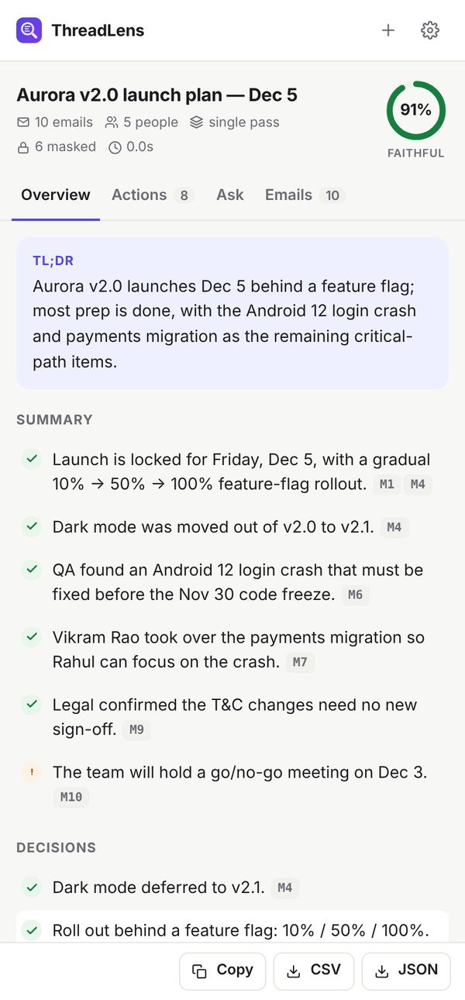
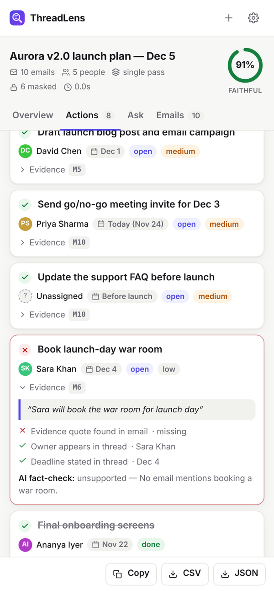
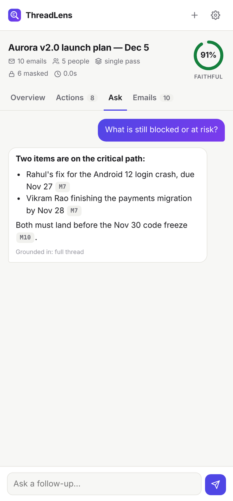

# ThreadLens - Email Thread Summarizer & Action Tracker

**PS 78 · Model Making** - a Chrome extension that turns a long email thread into a faithful summary and a list of action items with owners and deadlines. Every point is checked against the original emails, and you can ask follow-up questions in a built-in chat. Powered by Google Gemini.

<p>



</p>

<sub>UI preview with the bundled sample thread. The red card is a false claim planted on purpose to show that the verifier catches it.</sub>

---

## What it does

| | |
|---|---|
| **One-click capture** | Grabs the open Gmail thread (expands every email and strips quoted replies). You can also paste a thread, right-click selected text, or try a bundled sample. |
| **Summary** | A TL;DR, key points, decisions and open questions. Each one cites the emails it comes from (`M3`, `M7`…); click a citation to open that email. |
| **Action items** | Task, owner, deadline, status (open/done/blocked) and priority, plus the exact quote that supports it. Reassignments and completed tasks are taken from the latest email. |
| **Faithfulness check** | Each claim goes through two independent checks: (1) its quote must appear word-for-word in the cited email, and the owner and deadline must appear in the thread; (2) a separate Gemini call fact-checks it against only the cited emails. The result is a ✅ / ⚠️ / ❌ badge per claim and an overall faithfulness score. |
| **Long threads** | Quoted history is removed first (usually 70–80% of the text). If the thread is still long, it is split at email boundaries, processed in parallel and merged (map-reduce). Message IDs survive the split, so citations stay correct. |
| **Privacy** | Emails, phone numbers, Aadhaar/PAN numbers, cards, IPs and secrets are masked **on your device** before anything is sent. Participant names can be pseudonymised too. Real values are put back only in your browser. |
| **Ask (chatbot)** | Follow-up questions answered only from the thread, with citations and streaming replies. For very long threads it retrieves the relevant emails first. |
| **Export** | Copy as Markdown, or download CSV (action items) or JSON (everything). |

---

## Quick start (5 minutes)

**You need:** Google Chrome 116+, a free Gemini API key from <https://aistudio.google.com/apikey>, and Node.js 18+ *or* Python 3 (only to apply the `.env`).

1. **Unzip** the project.
2. **Add your key:** open `.env` and set `GEMINI_API_KEY=your-key-here`.
3. **Apply it:** run `node setup.js` (or `python setup.py`) in the project folder. This writes `extension/config.js`.
4. **Load the extension:** go to `chrome://extensions`, turn on **Developer mode** (top right), click **Load unpacked**, and select the `extension/` folder.
5. **Use it:** pin ThreadLens, open a Gmail thread, and click the icon (or press `Alt+Shift+T`). The side panel opens. Click **Grab thread from this tab**, then **Analyse thread**.

> No Node or Python? Skip steps 2–3 and paste the key in the extension's ⚙️ **Settings**. It is stored only in that browser.
>
> After editing `.env`, run setup again and click ↻ on the extension card in `chrome://extensions`.

**Demo without Gmail:** click one of the sample chips (*Product launch*, *Vendor outage (long)*, *Hiring loop (personal data)*), then **Analyse**.

---

## How it works

```
 Gmail tab / paste / right-click
            │
 ① PARSE     split into emails M1…Mn · strip quoted replies & signatures · de-duplicate · order by date
            │
 ② PROTECT   mask emails, phones, IDs, secrets (+ optional names) on-device  →  [EMAIL_1], [PERSON_2]…
            │
 ③ PLAN      ≤ limit → single pass          > limit → chunks cut at email boundaries (+1 email overlap)
            │                                           │ map: extract per chunk (parallel)
            │                                           │ reduce: merge, de-duplicate, later emails win
 ④ EXTRACT   Gemini, JSON schema: tldr · summary · decisions · action_items{task, owner, due, status,
            │                       priority, evidence (verbatim quote), source} · open_questions
            │
 ⑤ VERIFY    Layer 1 (code): quote exists in cited email? owner and deadline in thread? wrong citations corrected
            │ Layer 2 (Gemini fact-checker, sees ONLY the cited emails): supported / partial / unsupported
            │ → ✅ verified · ⚠️ needs review · ❌ unsupported   +  faithfulness score
            │
 ⑥ PRESENT   restore masked values locally → Overview · Actions · Ask (chat) · Emails · export
```

| PS 78 step | Where in the code |
|---|---|
| 1. Take a long email thread | `lib/extract.js` (Gmail/Outlook/selection), samples in `extension/samples/` |
| 2. Summarise + action items with owners | `lib/prompts.js` (schema + rules), `lib/pipeline.js` |
| 3. Check faithfulness | `lib/verify.js` (two-layer verification) |
| 4. Handle long threads via chunking | `lib/parser.js` (quote removal), `lib/chunker.js` (boundary chunking, BM25), map-reduce in `lib/pipeline.js` |
| 5. Discuss privacy | `lib/privacy.js` (reversible on-device masking), [`docs/PROJECT_REPORT.md`](docs/PROJECT_REPORT.md#5-privacy) |
| 6. Present results | `sidepanel.*` (UI), `lib/export.js`, `eval/` (metrics) |

---

## Likely jury questions (short answers)

**How do you verify faithfulness?**
The model must back every action item with a word-for-word quote and an email ID. Code then checks that the quote really appears in that email, that the owner is someone named in the thread, and that the deadline is stated. If the quote turns up in a different email, the citation is corrected. A second, independent Gemini call sees only the claim and the cited emails and labels it supported, partial or unsupported. An item is ✅ only if both layers agree. We measure the checker with `npm run eval`, which plants false items (invented task, wrong owner, wrong deadline) and counts how many are caught.

**How do you handle very long threads?**
(1) Remove quoted replies and signatures. This is usually 70–80% of a raw thread. (2) If it is still above the token budget, split it at email boundaries, never mid-email, with a one-email overlap for context. (3) Extract each chunk in parallel. (4) Merge the chunk results chronologically, so later emails override earlier ones ("done", "reassigned to Vikram"). (5) Verify against the full original emails, so checking does not depend on chunking. In chat, BM25 retrieval picks the most relevant emails plus the latest one.

More detail, design trade-offs and the remaining jury questions are in **[docs/PROJECT_REPORT.md](docs/PROJECT_REPORT.md)**.

---

## Project structure

```
threadlens/
├── .env / .env.example     ← your settings (API key, model, privacy, chunk sizes)
├── setup.js / setup.py     ← writes extension/config.js from .env
├── extension/              ← load THIS folder in chrome://extensions
│   ├── manifest.json       MV3, side panel, minimal permissions
│   ├── background.js       opens side panel, right-click "Analyse selection"
│   ├── sidepanel.html/css/js   UI (light + dark mode)
│   ├── config.js           generated from .env
│   ├── lib/
│   │   ├── parser.js       split thread, strip quotes/signatures, IDs
│   │   ├── privacy.js      reversible on-device masking
│   │   ├── chunker.js      token budget, boundary chunking, BM25 retrieval
│   │   ├── gemini.js       REST client: JSON schema, streaming, retries
│   │   ├── prompts.js      all prompts + JSON schemas
│   │   ├── pipeline.js     end-to-end orchestration (map-reduce)
│   │   ├── verify.js       two-layer faithfulness checks
│   │   ├── chat.js         grounded follow-up Q&A
│   │   ├── extract.js      Gmail / page extraction
│   │   ├── settings.js     Settings > .env > defaults
│   │   └── export.js       Markdown / CSV / JSON
│   └── samples/            3 realistic threads (short, long, with personal data)
├── tests/test_core.mjs     16 offline tests (no API key needed)
├── eval/                   run_eval.mjs + gold labels → eval/results.md
└── docs/                   PROJECT_REPORT.md, screenshots
```

## Testing & evaluation

```bash
npm test          # offline unit tests: parsing, masking, chunking, verification, pipeline (mock LLM)
npm run eval      # real Gemini run on the 3 samples → precision/recall, owner accuracy,
                  # faithfulness, planted-error detection → eval/results.md
```

Run `npm run eval` once your key is set, and put the table from `eval/results.md` in your presentation.

## Configuration (`.env`)

| Key | Default | Meaning |
|---|---|---|
| `GEMINI_API_KEY` | - | Required |
| `GEMINI_MODEL` | `gemini-3.8-flash` | Any Gemini text model id (e.g. `gemini-3.6-flash`, `gemini-3.5-flash-lite`) |
| `REDACT_CONTACT_INFO` | `true` | Mask emails, phones, IDs, secrets before sending |
| `PSEUDONYMIZE_NAMES` | `false` | Also replace participant names with `[PERSON_n]` |
| `VERIFY_WITH_LLM` | `true` | Second-pass Gemini fact-check |
| `SINGLE_PASS_TOKEN_LIMIT` | `1500` | Above this, use map-reduce chunking (set low so the demo shows it; use ~8000 day-to-day) |
| `CHUNK_TOKENS` | `900` | Chunk size for map-reduce (~3000 day-to-day) |

## Troubleshooting

- **"No Gemini API key set"**: run setup after editing `.env` and reload the extension, or paste the key in Settings.
- **"Model not found"**: change `GEMINI_MODEL` to a model your key can use (check the list in AI Studio).
- **Grab finds nothing in Gmail**: open the thread itself, not the inbox list. Elsewhere, select the thread text first, or paste it.
- **Rate limit (429)**: the client retries automatically. Free-tier keys have per-minute limits, so wait a moment.

> ⚠️ Don't share the zip after putting a real key in `.env` / `config.js`.
